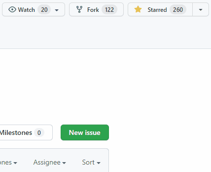

<!-- markdownlint-disable -->
## Azure Landing Zones Bicep - FAQ
<!-- markdownlint-restore -->

This wiki page answers frequently asked questions (FAQs) relating to the Azure Landing Zones Bicep modules.

Some FAQ questions that relate more to the architecture are based over in the CAF docs here: [Enterprise-scale architecture FAQ](https://learn.microsoft.com/azure/cloud-adoption-framework/ready/enterprise-scale/faq)

> Log an issue or create a pull request if you have a question that is not answered here, we are happy to help and have community contributions 👍

## List of Frequently Asked Questions

- [Why isn't `ALZ-Bicep` v1.x.x yet?](#why-isnt-alz-bicep-v1xx-yet)
- [How do I get notified of the latest releases in `ALZ-Bicep`?](#how-do-i-get-notified-of-the-latest-releases-in-alz-bicep)
- [Why are some linter rules disabled via the `#disable-next-line` Bicep function?](#why-are-some-linter-rules-disabled-via-the-disable-next-line-bicep-function)

---

## Questions & Answers

## Why isn't `ALZ-Bicep` v1.x.x yet?

Great question! Put simply this is because Bicep itself is not on a v1.X.X release yet which means there is a possibility for larger breaking changes still to occur in Bicep itself (upstream) which will in turn mean that these changes will have to be integrated into `ALZ-Bicep`.

This however, does not mean you shouldn't use ALZ-Bicep or Bicep as they are fully supported and ready for production usage.

As we use GitHub releases and tags you can clone and pin to a specific version in your codebase and upgrade when you are ready and willing to do so 👍

In summary, `ALZ-Bicep` will go v1.x.x when Bicep itself goes v1.x.x, give or take a few weeks for us to make any changes required in `ALZ-Bicep` upon the release of Bicep v1.x.x 👍

## How do I get notified of the latest releases in `ALZ-Bicep`?

There are a couple of ways you can ensure you get notified of the latest releases on the `ALZ-Bicep` repo.

1. Configure your "Watch" settings on the repo to notify you on "Releases"
    - See GitHub Docs on how to do this [here](https://docs.github.com/account-and-profile/managing-subscriptions-and-notifications-on-github/setting-up-notifications/configuring-notifications#configuring-your-watch-settings-for-an-individual-repository)



2. Sign-up to and use [newreleases.io](https://newreleases.io), add this repo `Azure/ALZ-Bicep` and select your email frequency.

## Why are some linter rules disabled via the `#disable-next-line` Bicep function?

In some of the ALZ-Bicep modules some of linter rules are disabled using the `#disable-next-line` Bicep feature. Today, this is primarily for disabling the [no-loc-expr-outside-params linter rule](https://learn.microsoft.com/azure/azure-resource-manager/bicep/linter-rule-no-loc-expr-outside-params) for the, optional, telemetry module as we want to ensure this telemetry deployment is stored in the same location as specified by the `location` input when deploying the Bicep module, instead of in the same location as specified by `parLocation` as this may be different from the region targeted by the deployment to ARM.

You may also see it in some location for resources that do not require a region for deployment, like Azure Policies, so instead of making users input an additional parameter for the region, we just use the one that was targeted by the deployment to ARM when the module was deployed.

It is not recommended to disable linter rules when it can be resolved by making changes to the Bicep code. However, in some scenarios, like above, this is necessary.

The custom policy definition modules (`customPolicyDefinitions.bicep` and `mc-customPolicyDefinitions.bicep`) also disable the [use-resource-id-functions linter rule](https://learn.microsoft.com/azure/azure-resource-manager/bicep/linter-rule-use-resource-id-functions) on the one line that copies each generated initiative child's `definitionId` into `policyDefinitionId`. The rule is still an error everywhere else.

That line has two separate problems, and fixing one doesn't fix the other:

1. The generated custom policy IDs are built with string interpolation, like `'${varTargetManagementGroupResourceId}/providers/Microsoft.Authorization/policyDefinitions/Deny-MgmtPorts-From-Internet'`, rather than with the resource ID functions the rule expects. The resulting IDs are correct, but they aren't in the form the rule asks for.
2. The linter can't follow `policySetDef.definitionId` through the loop variable back to where the value was defined. Newer Bicep versions type that property as a string, which is what makes the rule check it at all. Even if the generator emitted `extensionResourceId(...)` instead, this line would still fail.

Rebuilding the IDs on this line would mean telling built-in and custom IDs apart at deployment time, which adds logic without changing a single deployed value. Disabling the rule here keeps the deployed IDs, the explicit `parTargetManagementGroupId` target, and both cloud variants exactly as they were.

The tradeoff is that this line no longer gets the check, including for future changes to the generated policy data. Once the linter can follow loop variables, we should switch the generator to resource ID functions and remove both exclusions.

## Why do I see an error similar to `Cannot retrieve the dynamic parameters for the cmdlet` when running `bicep build` or trying to deploy a module?

This is normally due to the release version you are using of `ALZ-Bicep` was built using the latest available Bicep features from the latest [Bicep release](https://github.com/Azure/bicep/releases).

An example of the error or something similar you may see is shown below:

```powershell
VERBOSE: Using Bicep v0.5.6
New-AzManagementGroupDeployment: Cannot retrieve the dynamic parameters for the cmdlet. C:\Source\ALZ-Bicep\infra-as-code\bicep\modules\policy\definitions\customPolicyDefinitions.bicep(448,31) : Error BCP062: The referenced declaration with name "varPolicySetDefinitionEsDenyPublicpaasendpointsParameters" is not valid.
C:\Source\ALZ-Bicep\infra-as-code\bicep\modules\policy\definitions\customPolicyDefinitions.bicep(453,31) : Error BCP062: The referenced declaration with name "varPolicySetDefinitionEsDenyPublicpaasendpointsParameters" is not valid.
C:\Source\ALZ-Bicep\infra-as-code\bicep\modules\policy\definitions\customPolicyDefinitions.bicep(458,31) : Error BCP062: The referenced declaration with name "varPolicySetDefinitionEsDenyPublicpaasendpointsParameters" is not valid.
...
C:\Source\ALZ-Bicep\infra-as-code\bicep\modules\policy\definitions\customPolicyDefinitions.bicep(504,31) : Error BCP062: The referenced declaration with name "varPolicySetDefinitionEsDeployDiagnosticsLoganalyticsParameters" is not valid.
C:\Source\ALZ-Bicep\infra-as-code\bicep\modules\policy\definitions\customPolicyDefinitions.bicep(509,31) : Error BCP062: The referenced declaration with name "varPolicySetDefinitionEsDeployDiagnosticsLoganalyticsParameters" is not valid.
...
C:\Source\ALZ-Bicep\infra-as-code\bicep\modules\policy\definitions\customPolicyDefinitions.bicep(1222,65) : Error BCP082: The name "loadJsonContent" does not exist in the current context. Did you mean "loadTextContent"?
C:\Source\ALZ-Bicep\infra-as-code\bicep\modules\policy\definitions\customPolicyDefinitions.bicep(1224,71) : Error BCP082: The name "loadJsonContent" does not exist in the current context. Did you mean "loadTextContent"?
...
C:\Source\ALZ-Bicep\infra-as-code\bicep\modules\policy\definitions\customPolicyDefinitions.bicep(1252,112) : Error BCP062: The referenced declaration with name "varCustomPolicySetDefinitionsArray" is not valid.
C:\Source\ALZ-Bicep\policyDefinitions.bicep(3,15) : Error BCP104: The referenced module has errors.
```

You'll note that the error message above is stating it is using Bicep `v0.5.6` however, the `loadJsonContent` is available in `v0.7.4` and later.

So to fix this issue all you need to do is update the version of Bicep to the [latest release](https://github.com/Azure/bicep/releases) or follow the installation instructions here: [Install Bicep tools](https://learn.microsoft.com/azure/azure-resource-manager/bicep/install)

Then just re-run the deployment or `bicep build` and you should see success 👍🥳
